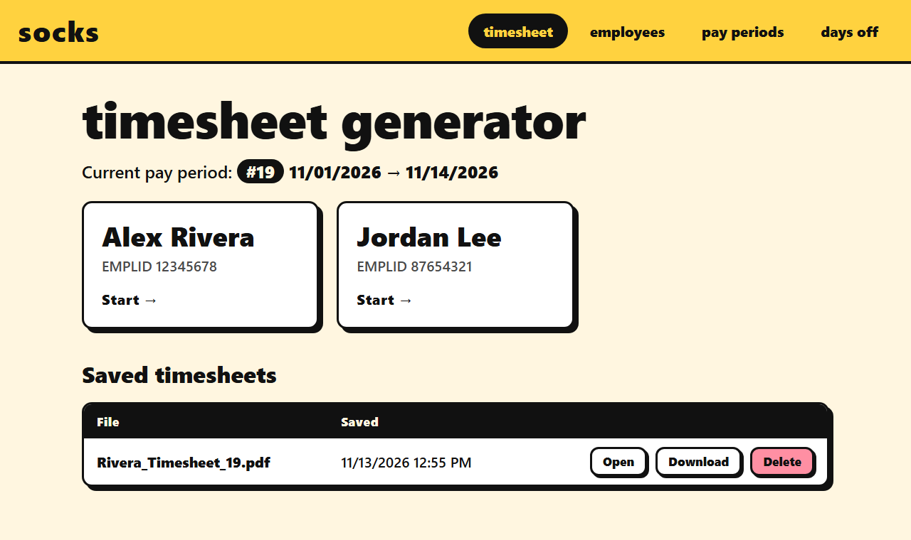
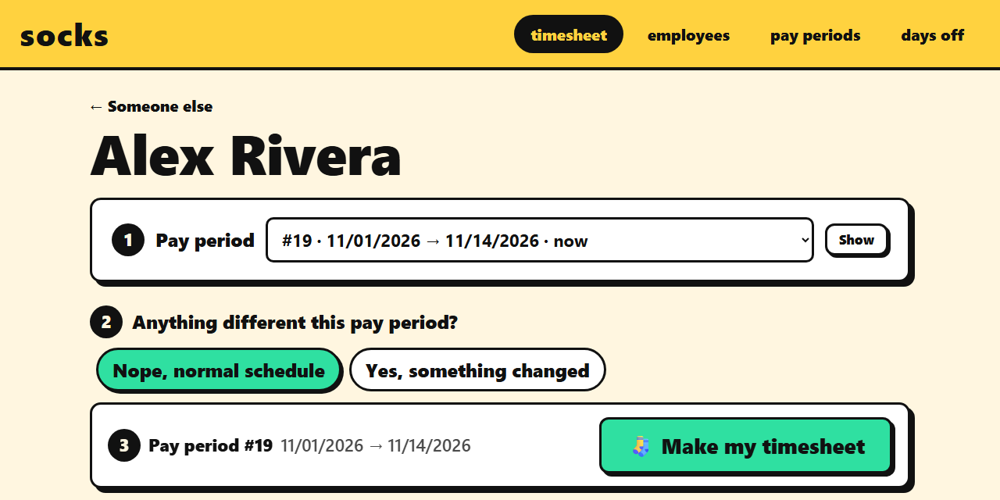
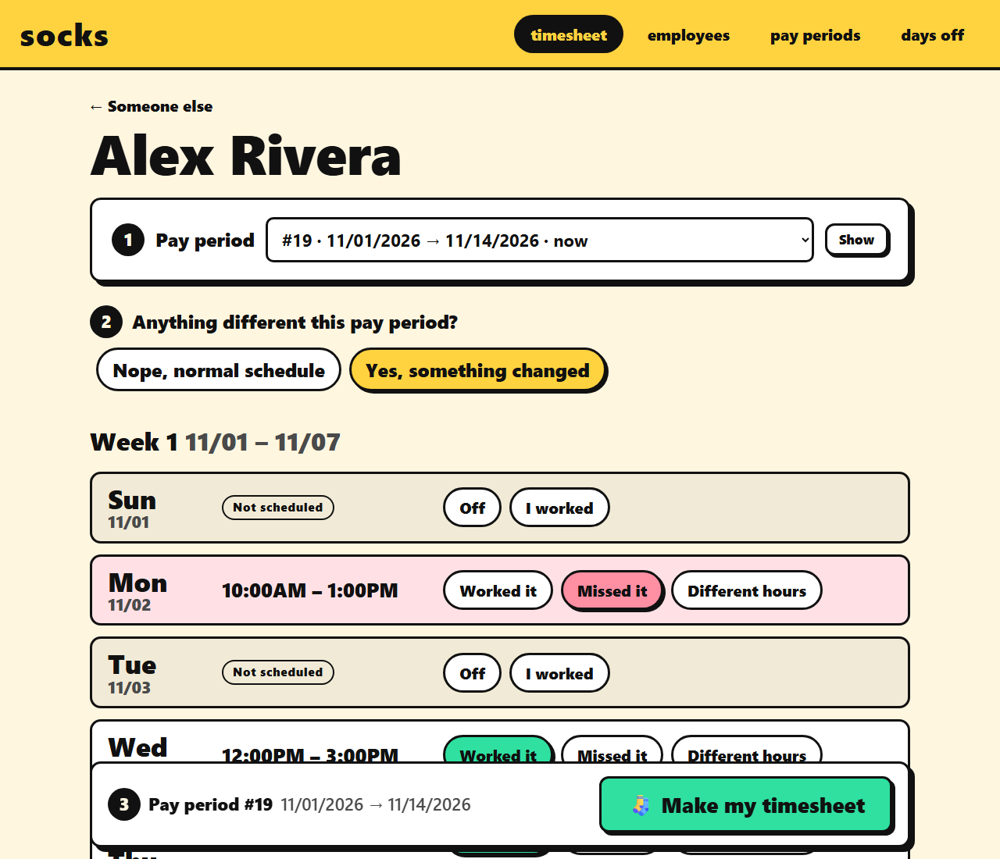
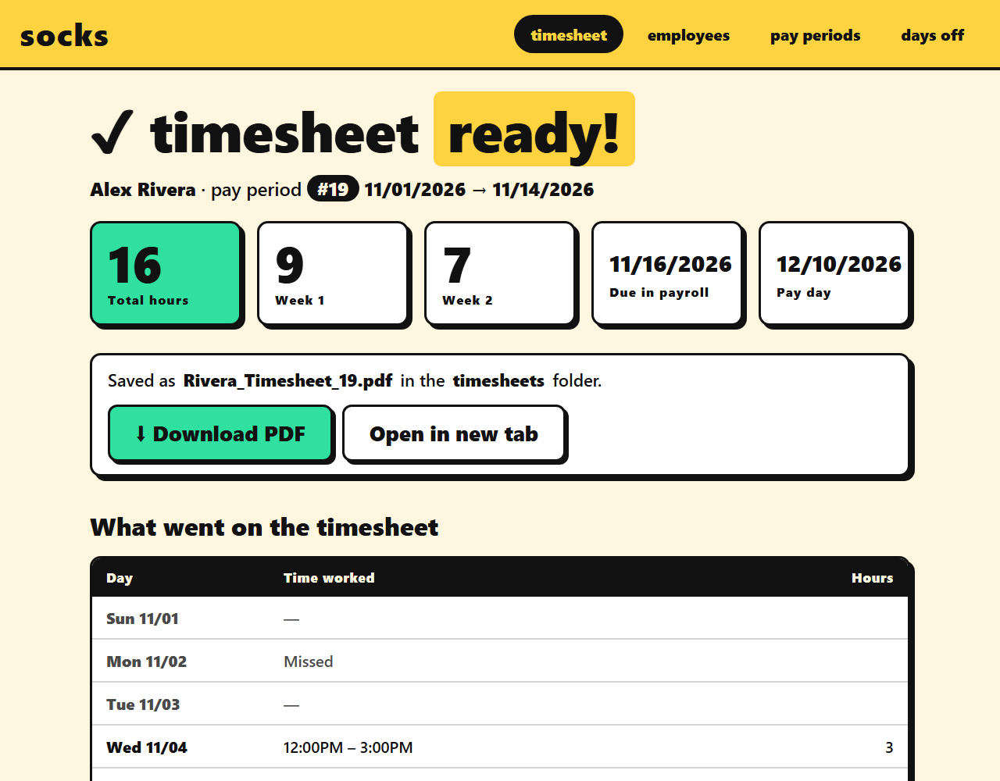
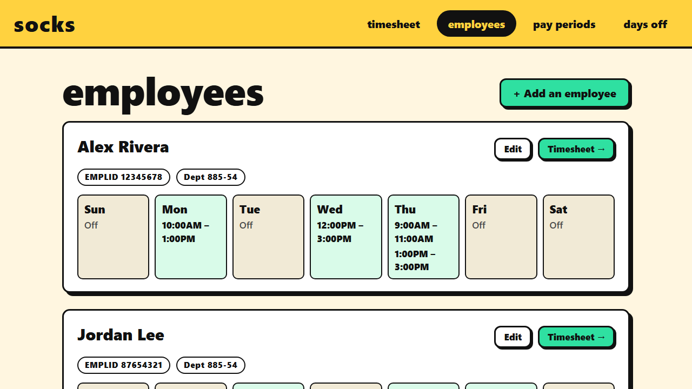
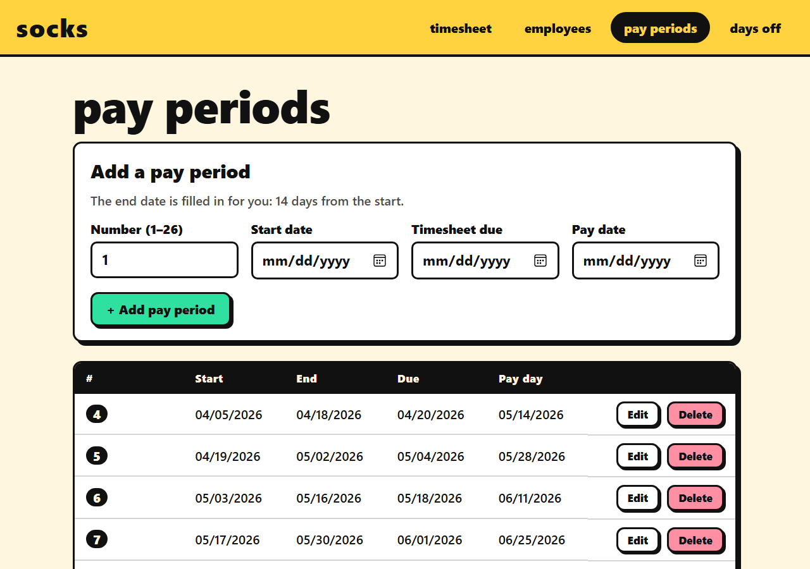

# Socks

A timesheet generator for Brooklyn College part-time workers. Use it from the command line or from a local web app in your browser.



## Setup
```sh
git clone https://github.com/ShawnEvans77/Socks
cd Socks
pip install -r requirements.txt
```

Run every command from the `Socks` folder. Both versions share the same database and the same `timesheets` folder.

The first time you run either version, Socks creates `resources/database/socks.db` from `starter.db`, which comes with the 2026-27 pay periods and days off but no employees. Add yourself on the **employees** tab or with `py -m crud.crud`. Your `socks.db` and your timesheets stay on your computer and are never committed.

## Run the web app
```sh
py -m web
```
Your browser opens to http://127.0.0.1:5050/.

- Press `Ctrl+C` in the terminal to stop it.
- `py -m web --port 5051` uses a different port. `--no-browser` skips opening the browser.
- It only listens on this computer. There is no login, so don't expose it to a network.

### Make a timesheet
1. On the **timesheet** tab, click your name.
2. **Pay period.** The current pay period is picked for you. Choose another one from the list if you need to.
3. **Anything different this pay period?** Leave it on **Nope, normal schedule** if you worked your usual hours.



If something changed, pick **Yes, something changed** to see every day in the pay period:
- **Worked it** / **Off**: the day goes on the timesheet as scheduled.
- **Missed it**: the day is left off.
- **Different hours** / **I worked**: enter the hours you actually worked, with an optional second shift.
- Split-shift days also let you tick off a single missed shift.



4. Press **Make my timesheet**. You get your total hours, hours per week, the due date and the pay date, plus the PDF to download or open.



Saved timesheets are listed on the home page, where you can open, download or delete them.

### Employees, pay periods and days off
These tabs replace the CRUD menu.

- **employees**: add an employee, or edit their EMPLID, budget and weekly schedule (split shifts included).
- **pay periods**: add, edit or delete pay periods. The end date is filled in 14 days after the start.
- **days off**: add holidays and other days when nobody is paid for scheduled hours.





#### Pay period backup
`resources/database/starter.db` holds the standard pay periods (#4 to #26, 04/05/2026 to 02/20/2027). If pay periods get deleted by accident, the **Backup** card on the pay periods page puts the missing ones back. It never changes pay periods you already have. Deleting a whole year sits at the bottom of the page and asks you to tick a box and confirm first.

## Run the command line app
```sh
py -m app.main
```

### Main app
Answer `n` to the last question to use your saved schedule.

```text
  ███████╗  ██████╗  ██████╗██╗  ██╗███████╗
  ██╔════╝ ██╔═══██╗██╔════╝██║ ██╔╝██╔════╝
  ███████╗ ██║   ██║██║     █████╔╝ ███████╗
  ╚════██║ ██║   ██║██║     ██╔═██╗ ╚════██║
  ███████║ ╚██████╔╝╚██████╗██║  ██╗███████║
  ╚══════╝  ╚═════╝  ╚═════╝╚═╝  ╚═╝╚══════╝

  ══════════════════════════════════════════════════
  [exit()] at any prompt to quit. [b] to go back
  ══════════════════════════════════════════════════

  ──────────────────────────────────────────────────
  [1/3]  Employee
  ──────────────────────────────────────────────────

  ▶ First name: shawn
  ▶ Last name: evans
  ✔  Welcome, Shawn Evans!
  ℹ  Using the EMPLID saved for this employee.

  ──────────────────────────────────────────────────
  [2/3]  Pay Period
  ──────────────────────────────────────────────────

  (y / n)
  ▶ Auto-detect current pay period?: y
  ℹ  Detected pay period 19  11/01  →  11/14

  ──────────────────────────────────────────────────
  [3/3]  Work Days
  ──────────────────────────────────────────────────

  (y / n)
  ▶ Any notable changes to account for this week?: n
  ℹ  No schedule changes. Using the saved schedule.

  ══════════════════════════════════════════════════
  Generating timesheet...
  ══════════════════════════════════════════════════

  ✔  Saved  →  Evans_Timesheet_19.pdf
  ℹ  Timesheet is due on 11/16/2026. You will be paid on 12/10/2026.
  ──────────────────────────────────────────────────
  Thanks for using Socks, Shawn!
  ──────────────────────────────────────────────────
```

### Recording changes
Answer `y` to record missed days, missed split shifts and extra days. Dates are typed the way they're listed, such as `11/02`. Separate several with spaces.

```text
  ──────────────────────────────────────────────────
  [3/3]  Work Days
  ──────────────────────────────────────────────────

  (y / n)
  ▶ Any notable changes to account for this week?: y
  (y / n)
  ▶ Did you miss any days this pay period?: y

  Available days:
  11/01 | 11/02 | 11/03 | 11/04 | 11/05 | 11/06 | 11/07 | 11/08 | 11/09 | 11/10 | 11/11 | 11/12 | 11/13 | 11/14

  ▶ Missed days (space-separated): 11/02
  ✔  1 missed day(s) recorded: 11/02
  (y / n)
  ▶ Did you miss your split schedule?: n
  ℹ  No split shifts missed.
  (y / n)
  ▶ Did you work an extra day or days this pay period?: y

  Dates in this pay period:
  11/01 | 11/02 | 11/03 | 11/04 | 11/05 | 11/06 | 11/07 | 11/08 | 11/09 | 11/10 | 11/11 | 11/12 | 11/13 | 11/14

  ▶ Extra work dates (space-separated): 11/07
  (y / n)
  ▶ Was the extra work on 11/07 a split schedule?: n
  (12-hour time, such as 9AM, 2:15PM, or 2:15 PM)
  ▶ start time for 11/07: 10AM
  (12-hour time, such as 9AM, 2:15PM, or 2:15 PM)
  ▶ end time for 11/07: 12PM
  ✔  Recorded extra work for 1 date(s).
```

- Type `b` at any prompt to go back a step, or `exit()` to quit.
- If an employee has no EMPLID saved yet, the app asks for it once and saves it. The web app does the same.
- If today isn't inside a saved pay period, answer `n` to auto-detect and type the pay period number.

## CRUD
```sh
py -m crud.crud
```

```text
  ╔════════════════════════════════════════════╗
  ║  SOCKS CRUD INTERFACE                      ║
  ║ [b] back  [q] quit here  [exit()] quit all ║
  ╠════════════════════════════════════════════╣
  ║   CREATE                                   ║
  ║   1  New Pay Period                        ║
  ║   2  New Invalid Date                      ║
  ║   3  New Employee                          ║
  ║   READ                                     ║
  ║   4  View Pay Period Schedule              ║
  ║   5  View Invalid Dates                    ║
  ║   6  Employee Names, EMPLIDs & Budgets     ║
  ║   7  View Employee Schedules               ║
  ║   UPDATE                                   ║
  ║   8  Update Pay Period                     ║
  ║   9  Update Invalid Date                   ║
  ║  10  Update Employee Schedule              ║
  ║  11  Update Employee Budget                ║
  ║   DELETE                                   ║
  ║  12  Delete Pay Period(s)                  ║
  ║  13  Delete Invalid Date(s)                ║
  ╠════════════════════════════════════════════╣
  ║   m  Show menu                             ║
  ╚════════════════════════════════════════════╝
```

## Notes
- Data is stored in `resources/database/socks.db`, which git ignores. Delete it to start over from `starter.db`.
- The main app asks about schedule changes once. Answering `n` uses the saved schedule without asking about missed or extra days.
- Answering `y` lets employees record missed days, missed split intervals, and extra workdays.
- Changes are only for the timesheet being made. They never change the saved schedule.
- CRUD and the web app can add employees with required EMPLIDs, budgets, and seven-day schedules, including split shifts.
- Employees can have split shifts. Generated PDFs are flattened and include the EMPLID, Prepared by name, checked CA box, and department number `885-<budget>`.
- Existing employees default to budget `54`, producing department number `885-54`.
- Days off (invalid dates) are left off every timesheet, unless you record extra hours worked on that day.
- Timesheets are saved in `timesheets` as `<Last>_Timesheet_<period>.pdf`.

## Tests
```sh
py -m unittest
```

## Motivation
Filling out timesheets and remembering pay period dates was tough, so I built Socks to make it easier.
